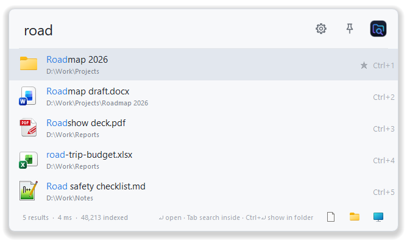
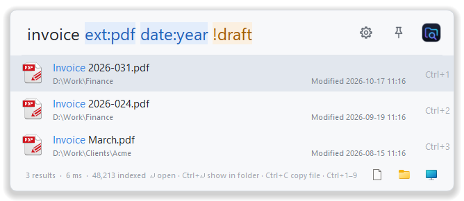
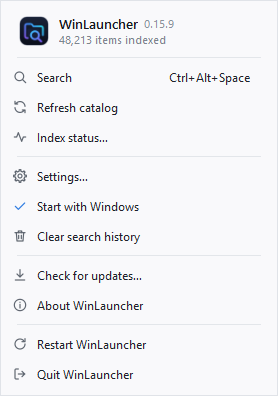
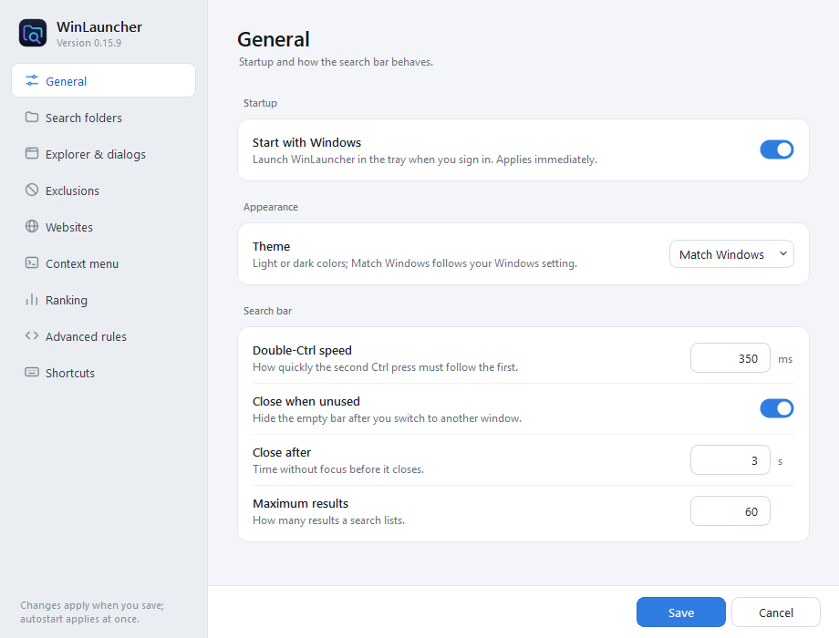
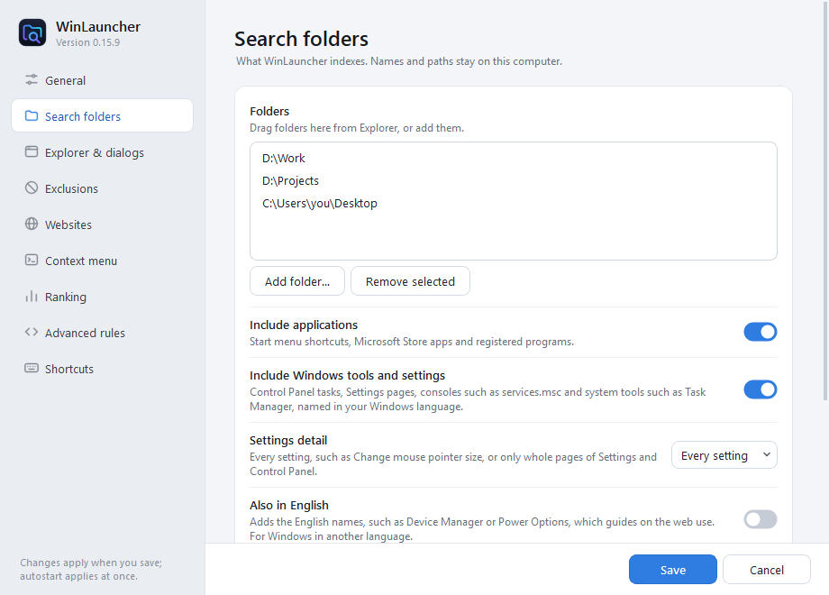
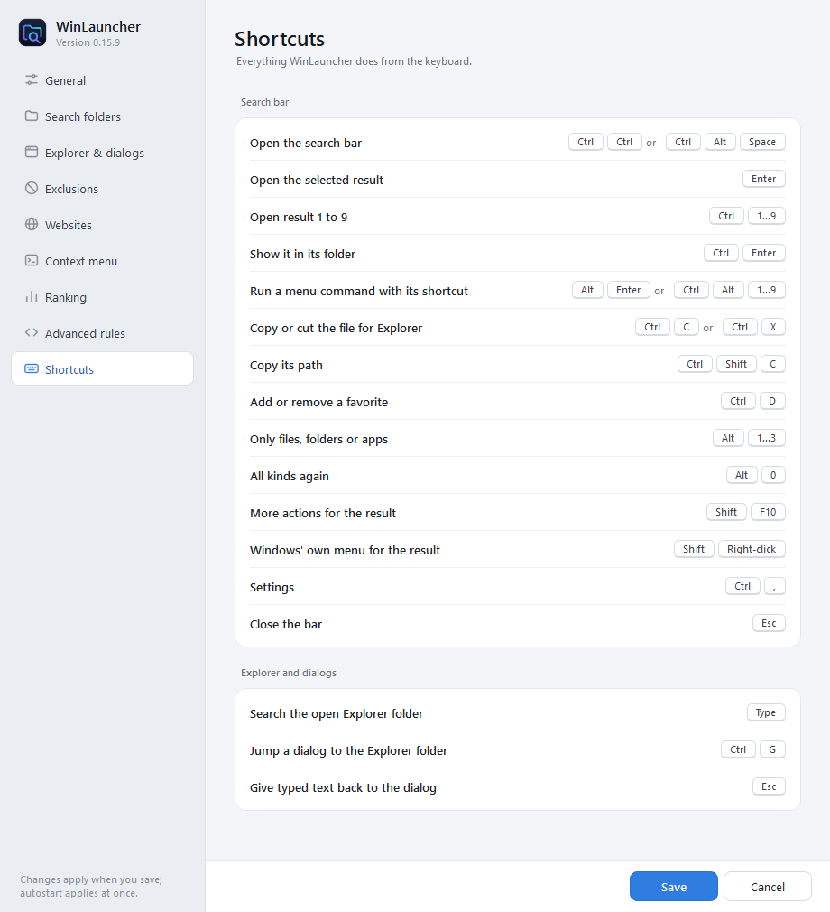
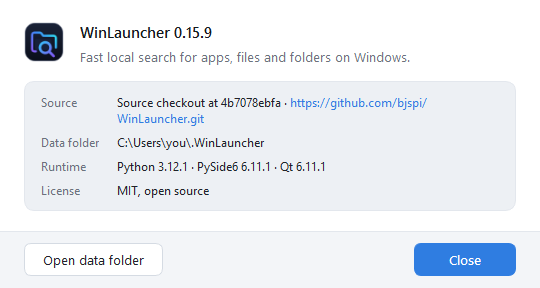
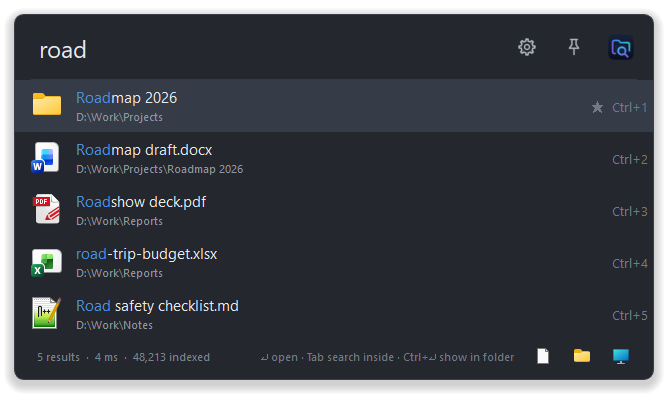
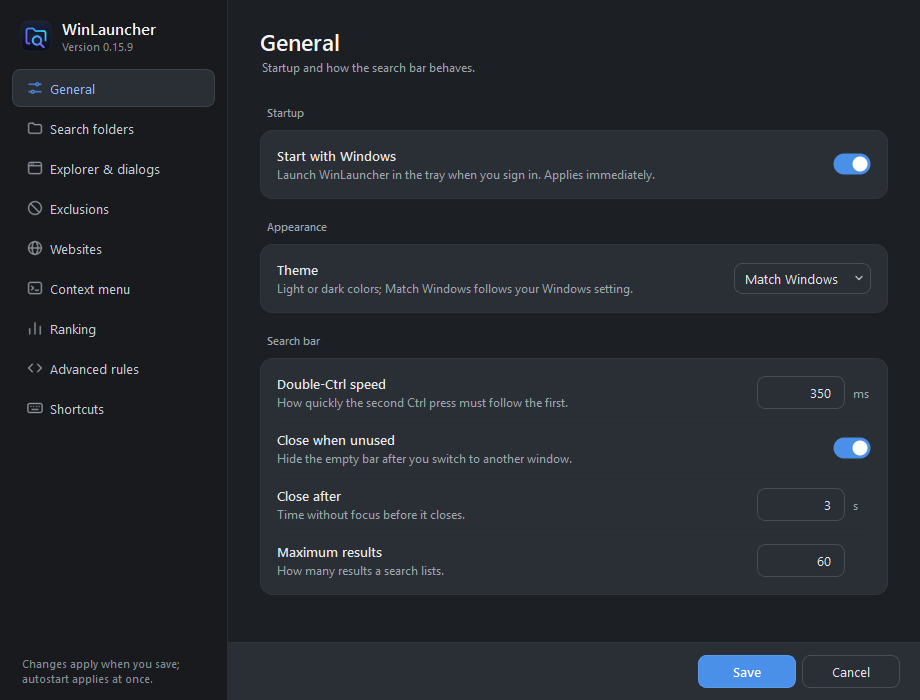
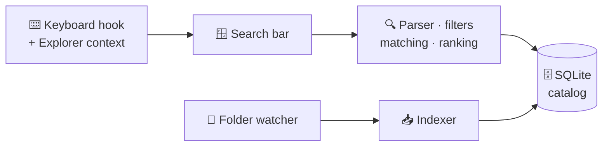

<div align="center">


# WinLauncher

**Double-tap <kbd>Ctrl</kbd>. Type a few letters. Open anything.**

A fast, private launcher for Windows that finds your apps, files and folders —<br>
or searches the folder you are in when you simply start typing in Explorer.

[](#-requirements)
[](https://www.python.org/)
[](https://doc.qt.io/qtforpython-6/)
[](https://www.sqlite.org/)
[](#-privacy)
[](https://docs.astral.sh/ruff/)
[](LICENSE)



</div>

---

## ✨ Highlights

| | |
| --- | --- |
| ⚡ **Instant launcher** | Double-tap <kbd>Ctrl</kbd> or press <kbd>Ctrl</kbd>+<kbd>Alt</kbd>+<kbd>Space</kbd> anywhere. A compact bar opens; results appear as you type. |
| 📂 **Type-to-search in Explorer** | Start typing in an Explorer file list and a slim bar docks to that window, searching the folder you are in — its own entries first. |
| 🔀 **Quick Switch in Open/Save dialogs** | Type in a dialog's file list to search everywhere: a folder opens in the dialog, a file fills in its name. <kbd>Ctrl</kbd>+<kbd>G</kbd> jumps the dialog to the folder of your last Explorer window. |
| 🧩 **Every installed app** | Start menu programs, Microsoft Store apps such as Telegram Desktop or the Calculator, and registered programs — found without adding a folder, shown with their own icons. |
| ⚙️ **Windows tools and settings** | Settings pages, Control Panel tasks, consoles such as `services.msc` or `gpedit.msc` and tools such as Task Manager — named in your Windows language, optionally in English too. Index every single setting or just the pages. |
| 🧠 **Smart matching** | Exact, prefix, word starts, camelCase initials (`vsc` → *Visual Studio Code*) and fuzzy subsequences, with matched letters highlighted. Umlauts are optional: `lohn` finds *Löhne*, and what you spell exactly comes first. |
| 📈 **Learns what you open** | Launches per query, favorites and recency lift the results you actually use. |
| 🧮 **Built-in calculator** | Type `200 + 10%`, `sqrt(2)` or `hex(255)` and the result appears above the search results; <kbd>Enter</kbd> copies it. |
| 🌐 **Website keywords** | Define a title, keyword and URL in Settings → Websites. `az headphones` searches Amazon; `yt Python tutorial` searches YouTube. |
| 💬 **Search plugins** | Chats, contacts and records of other programs as results, opened by a deep link into their app. `tg anna` puts your Telegram chats on top without hiding files, `@tg anna` answers from Telegram alone. Install them from [WinLauncher-Plugins](https://github.com/bjspi/WinLauncher-Plugins), your team's repository or a local folder, right in Settings ([more](#-search-plugins)). |
| 🖱️ **Your own menu commands** | Right-click a folder → **Open in Windows Terminal** or **Open Command Prompt here**, or add any command line of your own in Settings → Context menu. |
| 🎯 **Rich query language** | `type:`, `ext:`, `in:`, `path:`, `name:`, dates, sorting, `!exclusions` and more, colored as you type; invalid values are underlined. |
| 🚫 **Clean results by default** | Skips `.git*`, caches (`__pycache__`, `.ruff_cache`, `.mypy_cache`, …), virtual environments under any name, `node_modules`, `build`, `dist`, Gradle folders and folders marked with `.nobackup`. |
| 🔄 **Always current** | Watches your folders live; file changes refresh exactly that file, folder changes only their subtree. |
| ⌨️ **Keyboard first** | <kbd>Enter</kbd> opens, <kbd>Ctrl</kbd>+<kbd>1</kbd>…<kbd>9</kbd> opens a numbered result, <kbd>Ctrl</kbd>+<kbd>Enter</kbd> shows it in its folder. |
| 🌗 **Light or dark** | Follows the Windows color scheme, or stays light or dark as you choose in **Settings → General**. |
| 🔒 **Private** | No telemetry. File searches stay local; website searches open in your browser. Settings and the catalog stay in `%USERPROFILE%\.WinLauncher`. |
| ⬆️ **Release updates** | WinLauncher notices new releases. A git checkout updates itself with one click; pipx installs get the exact command to run. |

<div align="center">

</div>

Typing in Explorer opens a compact completion bar, docked to the bottom right of
the window. Matching direct folders come first, followed by direct files; matches
from subfolders follow below a blue separator. Explorer selects the best direct
match and follows the arrow keys. Direct folder names are read live, including
folders containing `.nobackup` or `.no-backup`; their contents stay excluded from
indexing and recursive search. Clicking a folder or pressing Enter navigates the
original Explorer tab, without opening another window. Clearing the scope returns
to the global launcher.

**Quick Switch** brings the same bar to Open and Save dialogs. Click into a
dialog's file list and start typing to search all your folders, wherever the
dialog opened; typing in the file-name box stays ordinary typing (<kbd>Esc</kbd>
puts what you typed back into the file-name box): choosing a folder
opens it in the dialog, choosing a file opens its folder and enters its name in
the file-name box. WinLauncher never confirms the dialog for you, so a Save dialog
cannot overwrite anything until you press <kbd>Enter</kbd> yourself. In any Open or
Save dialog, <kbd>Ctrl</kbd>+<kbd>G</kbd> jumps to the folder of the Explorer window
you used last; the file name you had typed stays. Turn it off in **Settings →
Explorer & dialogs**.

## 🚀 Quick start

### With pipx (recommended)

[pipx](https://pipx.pypa.io/) installs WinLauncher into its own environment and adds
a `winlauncher` command that starts without a console window:

```powershell
pipx install "winlauncher[rust] @ git+https://github.com/bjspi/WinLauncher.git@v0.15.9"
winlauncher --show
```

On Windows x64, the first start installs a small WinLauncher EXE with its own
name and icon in `~/.local/bin`, adds a Start-menu shortcut, migrates an existing WinLauncher autostart shortcut,
and uses it for future starts and restarts. Python stays in its existing environment;
no Rust compiler is needed. Windows may ask you to show the new tray entry once.
Press the Windows key and search for WinLauncher to open it, even with autostart disabled.

The `[rust]` extra downloads the matching Rust search engine wheel from the
GitHub release — no compiler needed. When a new release is out, WinLauncher says
so and shows the command to install it: the same line with the new tag and
`--force`. `pipx uninstall winlauncher` removes the
program; your settings and catalog in `%USERPROFILE%\.WinLauncher` stay.

### From a checkout

```powershell
git clone https://github.com/bjspi/WinLauncher.git
cd WinLauncher
python -m venv .venv
.\.venv\Scripts\python.exe -m pip install -e ".[rust]"
.\.venv\Scripts\python.exe -m winlauncher
```

`[rust]` adds the fast Rust search engine (needed for `contains:`) as a prebuilt
wheel from the matching [GitHub release](https://github.com/bjspi/WinLauncher/releases).
WinLauncher updates a checkout only to release tags, never to unreleased commits,
because only releases ship the matching engine: **Check for updates** in the tray
menu fast-forwards to the newest release (local changes are never overwritten),
and the next start reinstalls the packages before loading the engine. After a
manual `git pull`, run the install line again. Without the
extra — or on a commit newer than the latest release — WinLauncher still works
with its slower Python engine and says so in the search bar; you can also
[build the engine yourself](#rust-search-engine).

Afterwards, start it without a console window:

```powershell
.\Start-WinLauncher.ps1               # start quietly in the tray
.\Start-WinLauncher.ps1 -Show         # start and open the search bar
```

WinLauncher starts with your Desktop, Documents and Downloads plus installed
applications — Start menu programs and Microsoft Store apps alike. Add your work
folders in **Settings → Search folders** — or just drag them from Explorer into
the list. The first scan runs in the background.

Tick **Start with Windows** in the tray menu or in Settings to launch WinLauncher at
sign-in. It manages only its own shortcut in your Startup folder.

If you open the launcher, type nothing and switch to another window, it closes
after 3 seconds. Change the delay or turn this off in **Settings → General**. A
typed query keeps the launcher open. The search bar inside Explorer
closes as soon as you click elsewhere.

In **Settings → Websites**, edit or add a keyword, title and URL. Google, Amazon,
YouTube, Google Maps, eBay, Kleinanzeigen and IMDb are included by default.
Use `%s` for search text:

| Keyword | Title | URL |
| --- | --- | --- |
| `g` | Google | `https://www.google.com/search?q=%s` |
| `az` | Amazon | `https://www.amazon.de/s?k=%s` |
| `yt` | YouTube | `https://www.youtube.com/results?search_query=%s` |
| `gm` | Google Maps | `https://maps.google.com/?q=%s` |
| `eb` | eBay | `https://www.ebay.com/sch/i.html?_nkw=%s` |
| `ka` | Kleinanzeigen | `https://www.kleinanzeigen.de/s-%s/k0` |
| `imdb` | IMDb | `https://www.imdb.com/de/find/?q=%s&` |

Type `az headphones` and press Enter to search, or just `az` to open the site's
home page. URLs without `%s` open the exact saved page. Search text keeps its case,
spaces and punctuation and is URL-encoded automatically. Website keywords work
in the global launcher with the **All** filter; Explorer searches keep their file
behavior. Keywords are unique regardless of case. Save applies changes immediately
and keeps Settings open. Cancel / Close discards only edits since the last save.
Favicons load in the background directly from each site's
`/favicon.ico`; unavailable icons use a globe.

In **Settings → Context menu**, add your own entries to a result's right-click
menu: a title, a command line and whether it shows for folders, files or both.
**Open in Windows Terminal** and **Open Command Prompt here** are included for
folders by default:

| Title | Command line |
| --- | --- |
| Open in Windows Terminal | `wt.exe -d "{folder}"` |
| Open Command Prompt here | `cmd.exe /k pushd "{folder}"` |
| Open Claude Code here (example) | `wt.exe -d "{folder}" cmd /k claude` |
| Open in VS Code (example) | `code "{path}"` |

`{folder}` is the folder (or a file's folder), `{path}` the folder or file itself
and `{name}` its name; quote them, since paths may contain spaces. `%VARIABLES%`
such as `%LOCALAPPDATA%` are expanded. Programs start in `{folder}`, and console
programs get a window of their own. Apps have no own commands.

Windows Terminal runs what follows its options in the new tab, so no `&&` is
needed; `cmd /k` keeps the prompt open after Claude Code ends. Replace `claude`
with `codex` or `copilot` for those tools; **Duplicate** copies an entry to start
from. Each entry shows its program's icon, or an `.ico`, `.png`, `.svg`, `.webp`, `.exe` or `.dll`
file you choose under **Icon**.

Give an entry a **Shortcut** to run it without the menu: with **Alt**, for
example, <kbd>Alt</kbd>+<kbd>Enter</kbd> runs it on the selected result,
<kbd>Alt</kbd>+click on the clicked one and <kbd>Ctrl</kbd>+<kbd>Alt</kbd>+<kbd>1</kbd>
on the first. **Alt**, **Shift** and **Alt+Shift** are available, so Claude Code,
Codex and Windows Terminal can each have one. Ctrl is already taken by the
built-in keys and Ctrl+Alt is AltGr on many keyboards.

### 📋 Requirements

- Windows 10 or 11
- Python 3.11 or newer;
  the Rust engine wheel supports Python 3.11 to 3.14
- An ordinary user account — no administrator rights, services or drivers

## ⌨️ Keyboard

| Keys | Action |
| --- | --- |
| <kbd>Ctrl</kbd> <kbd>Ctrl</kbd> | Show or hide the search bar |
| <kbd>Ctrl</kbd>+<kbd>Alt</kbd>+<kbd>Space</kbd> | Alternative global shortcut |
| Typing in Explorer | Complete direct folder/file names; search below only without a direct match |
| Typing in an Open/Save dialog's file list | Quick Switch: open a folder in the dialog or enter a file's name |
| <kbd>Ctrl</kbd>+<kbd>G</kbd> in an Open/Save dialog | Jump to the folder of the last used Explorer window |
| <kbd>↑</kbd> <kbd>↓</kbd> | Select a result |
| <kbd>Enter</kbd> | Open the selected result |
| <kbd>Tab</kbd> on a folder | Search inside that folder; <kbd>Shift</kbd>+<kbd>Tab</kbd> moves to its parent, <kbd>Backspace</kbd> in the empty field searches everywhere again |
| <kbd>Ctrl</kbd>+<kbd>1</kbd> … <kbd>Ctrl</kbd>+<kbd>9</kbd> | Open the numbered result |
| <kbd>Ctrl</kbd>+<kbd>Enter</kbd> | Show the result in its folder |
| <kbd>Alt</kbd>+<kbd>Enter</kbd> / <kbd>Alt</kbd>+click / <kbd>Ctrl</kbd>+<kbd>Alt</kbd>+<kbd>1</kbd>…<kbd>9</kbd> | Run your own command whose shortcut is Alt (also Shift or Alt+Shift) |
| <kbd>Ctrl</kbd>+<kbd>Shift</kbd>+<kbd>C</kbd> | Copy the path |
| <kbd>Ctrl</kbd>+<kbd>D</kbd> | Toggle favorite |
| <kbd>Ctrl</kbd>+<kbd>P</kbd> / pin button | Keep the bar open after opening results; <kbd>Esc</kbd> still closes it |
| <kbd>Ctrl</kbd>+<kbd>L</kbd> | Select the query |
| <kbd>Ctrl</kbd>+<kbd>,</kbd> | Settings |
| <kbd>Shift</kbd>+<kbd>F10</kbd> / right-click | Open, reveal, your own commands, copy, favorite, exclude |
| <kbd>Esc</kbd> | Hide (indexing keeps running in the tray) |

Click the icon at the right of the bar for the **All / Apps / Files / Folders**
filters, refresh, an expanded view, settings, About and restart. Right-click a
result → **Exclude this or a parent folder…** to drop just that entry or a noisy
folder tree; the picker shows how many catalog entries each choice removes. For a
Windows setting or Store app it offers only the entry itself. **Custom rule…** turns
the chosen folder into an exclusion pattern you edit first, for example
`**\patches\src` for every `src` folder directly inside a `patches` folder.

The three icons in the bottom bar restrict results to **Files / Folders / Apps**.
Click the selected icon again for **All**, or use **Alt+1 / Alt+2 / Alt+3** and
**Alt+0** for All. Typed `type:file`, `type:folder` (or `type:dir`) and `type:app` filters update
these buttons; choosing a button replaces any typed kind override.
Use `t:` as shorthand for `type:`, for example `t:dir`, `t:file` or `t:app`.

## 🔍 Query language

```text
report                                  name or path contains "report"
lohn                                    also finds Löhne; löhn lists Löhne first
vsc type:app                            initials of an application
*.json                                  shell-style filename wildcard
report[0-9].json                        one digit in the filename
report ext:pdf,docx                     only these extensions
ext:doc,docx                            Word document extensions
ext:pdf;docx                            ; separates lists like ,
ext:doc*                                any extension starting with doc
ext:(jpg,png)                           either extension; parentheses are optional
"project plan"                          exact phrase: no initials or fuzzy matching
budget in:"D:\Work Projects"            inside this folder
budget D:\Work\                         same as in:D:\Work (note the trailing \)
rechnungen\ 2024                        "2024" inside a folder matching rechnungen
work\client\ proposal                   parent folders in this order
path:projects/reports name:annual       ordered parent folders, name only
report after:2025-06-01 sort:modified   changed since June 2025, newest first
report date:today                       modified since midnight
report date:week                        modified during the last 7 days
date:2026-07                            modified in July 2026
date:2026-01..2026-06                   modified in the first half of 2026
date:>=2026-03                          modified since March 2026
size:>5mb size:<1gb                     files larger than 5 MB and smaller than 1 GB
size:10mb..1gb                          between 10 MB and 1 GB, inclusive
report after:2026-02* before:2026-02*   reports modified during February 2026
report !archive                         exclude paths containing "archive"
report -archive -"old version"          - works like !
report !ext:tmp,bak                     exclude these extensions
report !*.bak                           exclude one extension
report contains:"invoice number"        filter matching text files by their contents (Rust)
*.json contains:gsk_*                   fnmatch pattern within text contents (Rust)
*.json rg:gsk_*                         content: and rg: are aliases for contains:
report match:keyword score:match        no fuzzy matching, text relevance only
report low:true                         include low-priority results
%TEMP%                                  open the Windows temporary directory
%LOCALAPPDATA%                          open local application data
~/                                      list the user directory's direct children
~/.config                               open this folder even outside indexed roots
D:\Work\                                list this folder's direct children without indexing
D:\Work\Shared report.pdf               find this file directly, even outside indexed roots
```

Paste an absolute file path and use **Ctrl+Enter** or **Show in containing folder**
to open its folder with the file selected. Absolute paths use the same direct
navigation as `~/`; spaces belong to the path, and the quotes of Explorer's
"Copy as path" are removed. For a catalog search within a folder, use
`in:"D:\Work" report` (a leading `D:\Work\ report` now navigates instead). `%` suggestions and exact references such as
`%TEMP%` show the variable name and its full resolved path; `%TEMP%\` lists its contents.

| Filter | Meaning |
| --- | --- |
| `type:file` · `type:folder` · `type:dir` · `type:app` | Item kind; `t:` is shorthand for `type:` |
| `"exact phrase"` | Contiguous text only, without initials or fuzzy matching |
| `ext:pdf,txt` · `ext:pdf;txt` · `ext:(jpg,png)` · `ext:doc*` | Extensions/patterns, combined with OR (repeatable) |
| `in:"C:\Folder"` · `report C:\Folder\` | Search descendants of an absolute folder |
| `path:a/b` · `a\b\` | Parent folders in this order (repeatable) |
| `name:text` | Match the file name without extension |
| `!text` · `-text` | Reject paths containing `text` |
| `!ext:tmp,bak` · `-ext:tmp` · `!*.bak` | Reject these extensions |
| `match:keyword` · `match:fuzzy` | Matching style (default fuzzy) |
| `sort:score` · `sort:name` · `sort:modified` | Order (default score) |
| `score:combined` · `score:match` | With or without personal ranking |
| `after:YYYY-MM-DD` · `before:YYYY-MM-DD` | Modification date range, inclusive |
| `after:20260215` · `after:2026-W07-1` | Compact and other ISO 8601 day forms |
| `after:2026-` · `after:2026-02*` | From January 1 or February 1, 2026 |
| `before:2026-` · `before:2026-02*` | Through the end of 2026 or February 2026 |
| `date:today` · `date:yesterday` · `date:week` · `date:month` · `date:year` | Since midnight, yesterday, or the last 7, 30 or 365 days including today |
| `date:2026` · `date:2026-07` · `date:2026-07-15` | That whole year, month or day |
| `date:2026-01..2026-06` | From the first period through the last, inclusive |
| `date:>2026-07` · `date:>=2026-07` · `date:<2026-07` · `date:<=2026-07` | After, from, before or through that period |
| `size:>5kb` · `size:<2mb` | File/application size; also `>=` and `<=` |
| `size:10mb..1gb` | File/application size range, inclusive |
| `contains:"some text"` · `contains:gsk_*` | Case-insensitive text/fnmatch content filter; needs the Rust engine |
| `content:text` · `rg:text` | Aliases for `contains:`, with identical fnmatch behavior |
| `low:true` | Show low-priority results alongside the others |

Quoted text keeps spaces and matches exactly, apostrophes are literal and Windows
paths such as `C:\Work` stay ordinary search text; only a trailing `\` or `/` turns
a token into a folder filter. A dash inside a word (`my-file`) or on its own is
ordinary text. Date and size filters intersect, so `date:2026 after:2026-03` means
March to December 2026. Terms of one or two characters match names only, never
folders: almost every path contains a `d` from `D:\`. Use `path:` or `do/` to
match short folder names. The full contract is in the
[behavior specification](docs/specification.md).

Search terms support fnmatch patterns: `*`, `?`, `[abc]`, `[0-9]` and `[!0-9]`.
Patterns match the whole filename, including its extension; `name:` matches the
stem instead. Use `[[]` for a literal opening bracket. Patterns work inside
quotes, alongside ordinary fuzzy terms and with filters. `path:` accepts the
same patterns for individual parent folders; `!text` remains a literal exclusion,
except `!ext:` and the exact form `!*.bak`, which exclude extensions.

Extension filters also accept fnmatch patterns. `ext:doc,docx` finds exactly those
extensions; `ext:doc*` also includes `docm` and other extensions starting with
`doc`. Lists accept optional parentheses and spaces inside them, such as
`ext:(jpg, png)` or `ext:(doc*, pdf)`. Repeated `ext:` filters add alternatives.

Size units are case-insensitive: `b`/`byte`, `kb`/`kbyte`/`KiB`, `mb`/`mbyte`,
`gb`/`gbyte` and `tb`/`tbyte` (plural `bytes` forms also work). Each step is 1024;
without a unit the value is bytes. Decimal points or commas work (`size:>1.5mb`),
and `size:> 5kb` is accepted. Repeated size filters intersect their bounds.
Folder sizes are not calculated. Dates accept every ISO 8601 day that Python's
`date.fromisoformat` reads (`2026-02-15`, `20260215`, week dates such as
`2026-W07-1`). Partial dates accept a year or year-month, optionally ending in `-`
or `*`; `after:` starts the period and `before:` includes its final day, using
local time.
Size filters show approximate sizes on each result row; date filters show the
stored modification date. These labels use catalog metadata without reading
files while painting the UI.

`contains:` reads supported text files on demand after filename/path filters and
exclusions, before the final result limit. It builds no content index and runs on
the search worker with cancellation. JSON, Markdown, TXT, logs, CSV, configuration
and common source-code files are supported, including UTF-8 and BOM-marked UTF-16.
Files are not decoded, so ASCII text also matches in legacy encodings such as
Windows-1252. Binary data, Office documents, PDFs, files over 64 MiB and cloud
placeholders that would have to be downloaded first (OneDrive "online-only") are
skipped; unreadable or deleted files also do not match. PDFs with a text layer
would require a separate text extractor; image-only PDFs would additionally need
OCR. Narrow the filename, extension or folder first for large collections.

**Settings → Search folders → Content search threads** sets how many
files are scanned concurrently (1–16, default 4). This applies to `contains:`,
`content:` and `rg:`; filename search still uses the catalog. The Rust engine uses
ripgrep libraries directly, with reusable workers and no per-file processes.
Higher values can increase disk activity and memory use. Save applies the change
to the next search without rebuilding the catalog.

Content patterns match anywhere within a line and support `*`, `?`, `[0-9]` and
`[!0-9]`. They do not span lines. Regex punctuation such as `.` and `+` stays
literal; use `[*]`, `[?]` and `[[]` to search for literal wildcard characters.

### 🧮 Calculator

When the query is a calculation, its result appears above the search results and
is selected: <kbd>Enter</kbd> or a click copies it, <kbd>↓</kbd> moves to the
results, which are searched as usual.

```text
200 + 10%              220      percent of the left side for + and -
50% * 30               15       elsewhere 50% is 0.5
2^10 · 2**10           1024     power; also × and ÷
1,5 * 3                4,5      decimal commas are answered with commas
sqrt(2) · exp(1) · ln(e) · log(1000) · log(8, 2)
sin(pi/2) · cos · tan · asin · acos · atan · deg(pi) · rad(180)
floor(2.7) · ceil(2.1) · round(2.5) · round(2.345, 2) · abs(-3) · fact(5)
min(4, 2, 9) · max(1,5; 2) · mod(10, 3)
bin(10) · hex(255) · oct(8) · 0xff · 0b101 · 0o17
chr(65) · ascii(10) · ord(A) · hex2ascii(30323030) · ascii2hex(0200)
```

Constants are `pi`/`π`, `e` and `tau`; names ignore case. `log` is base 10 unless
a base is given, `ln` is natural, and angles are radians. Multi-argument
functions separate arguments with `,`, or with `;` when the numbers use decimal
commas. A lone number or constant (`2024`, `pi`) and digits joined by hyphens
(`2024-06-15`, `2024-2025`) stay searches. The calculator parses the text itself
and never runs Python code; results larger than about 1000 digits are not shown.

### 📁 Paths and shortcuts

Start with `%` to suggest Windows folders by name: every environment variable that
points to a folder (`%APPDATA%`, `%USERPROFILE%`, your own) plus known folders such
as `%DOWNLOADS%`, `%DESKTOP%`, `%STARTUP%` or `%SENDTO%`. Only names starting with
what you typed appear: `%user` shows `%USERPROFILE%`, not `%TEMP%`. A trailing `/` or `\` lists direct children;
`~/Doc` completes names below your user directory. These shortcuts work without
indexing that folder, run in the background and honor exclusions and markers.
`in:%USERPROFILE%` also expands variables when filtering the existing catalog.

## 💬 Search plugins

WinLauncher itself ships no plugin, only the host that loads, schedules and searches
them. They come from **plugin sources**, listed under Settings → Plugins → **Plugin
sources** — by default
**[WinLauncher-Plugins](https://github.com/bjspi/WinLauncher-Plugins)**, with
Telegram and a template for your own:

| Source | You get | You click |
| --- | --- | --- |
| 🌐 A git repository — GitHub, your company's git server, SSH | A copy in your plugins folder, its Python packages, and update notices | **Install and activate** · **Update** · **Uninstall** |
| 📁 A folder on this computer or a share | The plugin loads from where it lies — ideal while you write one | **Activate** · **Deactivate** |

Choose a plugin under **Available plugins**, click, and restart when WinLauncher
offers it: the plugin is on. Its keywords and options are under **Plugin
settings**, one card per plugin: folded to its icon, name and switch until you
open it, and WinLauncher remembers which ones you opened. Nothing from a source loads before you choose it, and a
plugin that fails to load or throws is listed as a problem and never takes
WinLauncher down. Repositories need [git](https://git-scm.com/); private ones use
your saved git credentials. [docs/plugins.md](docs/plugins.md) explains sources,
writing plugins, and how they run and are ranked.

## 🎛️ Exclusions and priorities

**Settings → Exclusions** takes absolute folders (drag & drop works), file/folder-name
patterns with `*`, `?` and `[…]` wildcards, and marker file names. Defaults:

- **Markers:** `.nobackup`, `.no-backup`, `pyvenv.cfg` (Python environments) and
  `conda-meta` (Conda environments) exclude their folder and everything below it.
- **Windows shortcuts:** `*.lnk` excludes shortcuts in your folders, including existing
  catalog results. Start-menu and registered applications stay searchable: file-name
  patterns do not apply to them (folder exclusions and markers still do).
- **Office temporary files:** `~$*` excludes lock/owner files such as `~$Report.docx`.
- **Folder names:** `.git*`, `.svn`, `.hg`, `__pycache__`, `.venv`, `venv`,
  `.ruff_cache`, `.mypy_cache`, `.dmypy_cache`, `.pytype`, `.pyre`, `.pyright`,
  `.basedpyright`, `.pylint.d`, `.pylint_cache`, `.lint_cache`, `.pytest_cache`,
  `pytest-cache-files-*`, `.tox`, `.nox`, `.hypothesis`,
  `.ipynb_checkpoints`, `.eggs`, `*.egg-info`, `node_modules`, `.next`,
  `.parcel-cache`, `build`, `dist`, `.gradle`, `.cxx`, `.externalNativeBuild`,
  `.vs`, `.idea`, `$Recycle.Bin`, `System Volume Information`.

Patterns match whole names, so `buildings` stays searchable.

Patterns with `\` or `/` match folder paths instead (either separator works). There,
`*` and `?` stay within one folder and `**` spans any number of folders:

```text
Projects\Android\*\build     build folders one level below any Projects\Android
Android/**/build             build folders at any depth below an Android folder
D:\Archive\*\cache           starts with a drive, so it matches only from D:\
```

**Settings → Ranking** boosts or demotes folders, one rule per line:

```text
25  | D:\Projects | high
-20 | D:\Archive  | low
0   | D:\Private  | ignored
```

**Advanced rules** add filename-regex, extension and Windows-attribute rules.
`ignored` hides an item completely, `low` makes it a fallback, `high` lifts it to
the top group; the number fine-tunes the order.

## 🖼️ A closer look

<div align="center">

| | |
| :---: | :---: |
| <br>Filters and exclusions are colored as you type | <br>The tray menu |
| <br>Settings: startup and the search bar | <br>Search folders, drag and drop included |
| <br>Every shortcut on one page | <br>About, with the data folder one click away |
| <br>The dark theme, chosen or following Windows | <br>Settings in the dark theme |

</div>

## 🔒 Privacy

- 🏠 Runs entirely on your computer. No account, telemetry or cloud service.
- 🌐 Configured websites are contacted for favicons when shown. Website search text
  is sent only when you open the result in your browser, and is not saved in the
  file search history. No third-party favicon service is used.
- 📄 Indexes names and metadata only — never file contents.
- 💬 WinLauncher ships no plugin, and none loads before you install or activate it.
  Each keeps its own data in `%USERPROFILE%\.WinLauncher\plugin-data`; whom a
  plugin talks to is up to that plugin.
- 🗂️ Settings, catalog, favorites, history and logs live in `%USERPROFILE%\.WinLauncher`
- 📝 `settings.json` holds user preferences. `winlauncher.log` rotates at 5 MB with five backups.
  Diagnostics record search timing, UI stalls, shortcut dispatch and focus owners
  (process names/PIDs, without query text or window titles). Log writes run in the background.
  Existing settings, favorites and history from `%LOCALAPPDATA%\WinLauncher` are copied
  on first start; originals are retained. Close an older running instance first.
  and contain your paths and queries; treat that folder like other personal data.
- 🧹 **Clear search history** in the tray forgets launches but keeps favorites.

## 🧩 How it works



Scans are staged and published atomically, so a cancelled or failed scan never
empties the catalog. Unreadable folders keep their previous entries while the rest
refreshes. Each search runs in the background and is cancelled as soon as you type
on. Read the [architecture notes](docs/architecture.md) for the details.

## 🧪 Development

### Rust search engine

The separate `winlauncher_native` package is WinLauncher's search engine: matching,
ranking, SQLite candidate reads and `contains:`. The Python ranking stays the
behavior reference, and the test suite checks that both produce identical scores,
reasons and order. The WinLauncher package itself needs no Rust dependencies; when
the extension is missing or does not fit this Python, WinLauncher searches with
the Python engine, shows why in the search bar and leaves `contains:` unavailable.

One abi3 wheel serves Python 3.11 to 3.14; it picks the Unicode tables of the
running interpreter (Unicode 14.0, 15.0, 15.1 and 16.0). Build it with Rust stable
for `x86_64-pc-windows-msvc` and Visual Studio Build Tools with **Desktop
development with C++**:

```powershell
python -m pip install maturin
python native\tools\build.py --out dist            # abi3 wheel without local paths
python -m pip install --force-reinstall (Get-ChildItem dist\winlauncher_native-*.whl).FullName
python -c "import winlauncher_native; print(winlauncher_native.API_VERSION)"
```

`native/tools/build.py` wraps `maturin build --release --locked` and remaps your
user folder, the checkout and the Cargo/rustup homes, so the wheel contains no
paths from your machine. After changing `native/Cargo.lock`, refresh the shipped
license texts with `python native\tools\collect_licenses.py`; after adding a
Python version, generate its Unicode tables with
`python -I native\tools\generate_unicode.py` using that interpreter.

`WINLAUNCHER_SEARCH_ENGINE` selects the engine for tests and diagnostics: `auto`
(default) uses Rust when available, `python` forces the reference engine, and
`native` requires the extension and fails instead of falling back. In `auto`, an
unexpected Rust error is logged once and that search is repeated in Python.
Filename regex rules run natively for ASCII names; other names, and syntax Rust's
regex cannot match exactly, call the rule's compiled Python pattern instead.

Compare the engines and the native phases:

```powershell
python tools\benchmark.py --engine python --entries 50000 --directories 1000
python tools\benchmark.py --engine native --phase rows --entries 50000 --directories 1000
python tools\benchmark.py --engine native --phase sqlite --entries 50000 --directories 1000
python tools\benchmark.py --engine native --phase memory --entries 50000 --directories 1000
cargo test --manifest-path native/Cargo.toml --locked
```

`WINLAUNCHER_NATIVE_PHASE` chooses where Rust reads candidates: the default
`memory` scans an in-memory copy of the catalog, `sqlite` runs the candidate SQL
in Rust and `rows` keeps SQLite reads in Python.

### Tests and checks

```powershell
python tools\check.py                           # standard checks; always cleans Rust debug files
python -m unittest discover -s tests -v          # unit, UI and integration tests
python tools\smoke_test.py --native              # real Qt flow + hook attach/detach
python tools\benchmark.py --entries 50000        # synthetic search benchmark
python tools\readme_screenshots.py              # regenerate the README screenshots
python -m ruff check winlauncher tests tools native/tools
python -m ruff format --check winlauncher tests tools native/tools
```

Tests use temporary catalogs, folders and git repositories; they never touch your
real settings, Startup folder or files.

📚 [Architecture](docs/architecture.md) ·
[Development notes](docs/development.md) ·
[Specification](docs/specification.md) ·
[Third-party notices](THIRD_PARTY_NOTICES.md)

## ⚠️ Limitations

- Windows only: the keyboard hook, Explorer integration, folder watching and
  autostart use Windows APIs.
- Paths longer than 260 characters are indexed and searched, but some programs
  cannot open them; Explorer and most current applications can.
- Indexes by walking folders and watching changes, not by reading the NTFS
  journal; very large drive-wide catalogs build slower. Without the Rust engine,
  broad one-letter searches over 50,000 entries take around half a second.
- Input methods (IME), Windows 11 tab edge cases, high-DPI multi-monitor setups and
  screen readers still need more real-world testing.
- Quick Switch works with the standard Windows Open and Save dialogs that show an
  address bar. Old-style dialogs and applications with their own file dialogs are
  left alone. In a "Select Folder" dialog, choosing a folder selects it, as typing
  its path would.

## 📄 License

[MIT](LICENSE) © WinLauncher contributors. Dependencies keep their own licenses — see
[third-party notices](THIRD_PARTY_NOTICES.md).
