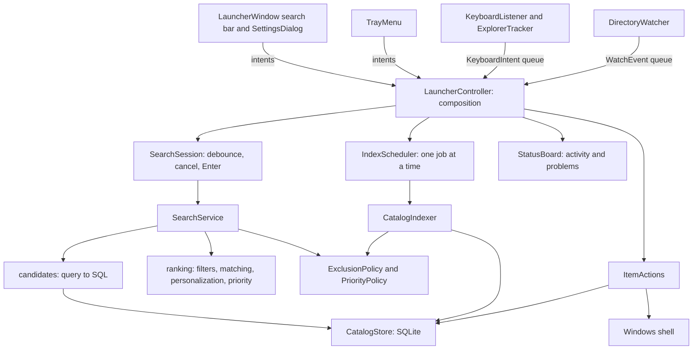

# Architecture

## Domain boundaries

WinLauncher is organized around catalog indexing, filesystem change monitoring,
query parsing, filtering, text matching, ranking, platform integration and UI state.
Value objects carry intent and policy; adapters own I/O. There is no service
locator, dependency-injection framework or shared database connection. The
controller composes the application explicitly.

| Module | Responsibility |
| --- | --- |
| `catalog/model.py` | Catalog values, `CatalogSource`, path identity (`path_key`) versus search normalization (`normalize`) |
| `catalog/exclusions.py` | Excluded paths, file/folder patterns and marker files, cached per operation |
| `catalog/priority.py` | Search classes (ignored/low/normal/high) and numeric boosts |
| `catalog/sources.py` | Which trees the catalog owns and which source owns a path |
| `catalog/indexer.py` | Scan policy, traversal, staging, reporting and publication decisions |
| `catalog/store.py` | SQLite schema and migration, staged snapshots, usage and favorites |
| `search/query.py` | The immutable parsed `SearchQuery` |
| `search/query_parser.py` | Tokenizing, recognized filters, value parsing and validation |
| `search/filters.py` | Structured eligibility: type, extension, scope, exclusions, dates |
| `search/matching.py` | Text match quality, ordered folder matching and fuzzy alignment |
| `search/ranking.py` | Eligibility, text relevance, personalization, configured priority, explanation |
| `search/candidates.py` | Query-to-SQL translation for the literal and fuzzy candidate passes |
| `search/memory_index.py` | What the Rust memory index loads and the candidate plans it evaluates |
| `search/service.py` | Streaming candidates into a bounded best-hits heap |
| `settings.py` | Validated settings value object and atomic JSON file |
| `actions.py` | Open, reveal, own menu command and favorite use cases; only successful opens are learned |
| `commands.py` | The user's context-menu commands and their command lines |
| `plugins/api.py` | The plugin interface: `Plugin`, `PluginItem`, `PluginContext`, options and commands |
| `plugins/registry.py` | Loads the own plugins folder, activated plugin folders and entry points; `PluginSource` |
| `plugins/folders.py` | Plugin folders on disk: `plugin.toml` manifests and the three layouts of a source |
| `plugins/encoding.py` | Plugin files and tool output in UTF-8 or Windows-1252, whichever they were written in |
| `plugins/sources.py` | Plugin sources: remote clones, local folders, what they offer, install and uninstall |
| `plugins/packages.py` | A plugin's Python packages, installed with pipx or pip into WinLauncher's environment |
| `plugins/host.py` | Each plugin's latest items and their cache, refresh, search, open and commands |
| `plugins/budget.py` | Times each plugin's ranking; leaves plugins over the time limit out of ordinary searches |
| `plugins/search.py` | Plugin keywords, which queries plugins answer, item ranking, merging with file hits |
| `platform/` | Win32 bindings, keyboard hook, Explorer COM, directory watching, shell, autostart |
| `platform/launcher.py`, `loader/` | Branded Windows process, its per-installation resources, PATH migration and application commands |
| `platform/shortcuts.py` | Folders of generated shortcuts the catalog indexes; `store_apps.py` and `windows_tools.py` fill them |
| `platform/windows_tools.py` | Control Panel tasks, Settings app pages, consoles and system programs, named by Windows |
| `platform/file_dialog.py` | Quick Switch: read an Open/Save dialog's folder and drive its file-name box |
| `platform/shell_menu.py` | Explorer's classic context menu for a result, through the shell's COM vtables |
| `ui/plugins.py`, `ui/plugin_settings.py` | Plugin refresh timers, questions from plugin workers, item icons, the Plugin settings page with one foldable card per plugin |
| `ui/plugin_sources.py`, `ui/source_settings.py` | Periodic source checks, update notices, installs and activations; the Plugins page: what sources offer, and the sources |
| `ui/` | Search bar window, result icons and highlighting, settings, exclusion picker and About dialogs, tray, status, search session, index scheduler, release updater, worker delivery |
| `ui/widgets.py` | The settings look: tinted line icons, animated switches, cards with setting rows, info dialogs |
| `ui/theme.py` | Light and dark colors, the stylesheet built from them, following the Windows color scheme; painters read `colors()` and refresh kept icons on `Theme.changed` |
| `platform/git.py` | Read-only git queries for self-updating a source checkout |
| `releases.py` | Release tags, installation kinds and their update commands |
| `install.py` | The reinstall that finishes a checkout update at the next start |
| `__main__.py` | CLI, logging, crash logging, per-data-directory single instance and restart handover |

`catalog/` and `search/` do not import Qt or Win32. Their behavior is tested with
temporary SQLite catalogs and ordinary filesystem fixtures. The search package
translates queries into SQL itself (`candidates.py`), so the catalog store does not
depend on the query language.

## Windows application host

On Windows x64, the version-independent Rust host loads the existing CPython DLL
and calls `Py_Main` in its own process. Qt therefore owns a tray icon belonging to
`winlauncher.exe`, whose icon and file description identify WinLauncher. The host
has no dependency on the optional Rust search engine or on a particular Python
minor version. Its checked-in binary and source fingerprint ship as package data;
source installs need no compiler, and app releases reuse the same host binary.

`platform/launcher.py` configures an installed copy in the user's `.local/bin`
(or `XDG_BIN_HOME`). Windows resources hold the real interpreter, base Python DLL,
package directory and entry module. No separate configuration file is needed.
CPython's `__PYVENV_LAUNCHER__` preserves the real environment's `sys.executable`;
pip and Python subprocesses use that interpreter. Application starts use
`application_command` instead. The GUI host forwards arguments without shell
parsing, and Python's exit code becomes the process exit code.

The elected instance finishes a pending update, installs or refreshes the host,
migrates an owned Startup shortcut, and hands a legacy Python start to the host.
The replacement waits for the same data-directory lock. Migration preserves the
shortcut's original arguments and custom data directory, never enables absent
autostart, and never replaces an unrelated command or shortcut. Updating a running
host renames the old image aside; later starts remove it after Windows releases it.
An installation failure is logged and the Python application remains usable.

## Catalog indexing

One scan is split along its responsibilities:

- `_EntryRules` decides whether an entry belongs in the catalog: links and offline
  folders, exclusions and ignored priorities. A scoped scan applies the same rules
  to every ancestor up to its source root (`allows_scope`). Disk errors propagate.
- `_ScanSession` walks directories. Entries stream from `os.scandir`; traversal
  state is a local pending-folder list. Each visit returns the subfolder to descend
  into, so no mutable state is passed through parameters.
- `catalog/long_paths.py` gives every `stat`/`lstat`/`scandir` call the
  extended-length form for paths of 240 characters or more and turns entry paths
  back into ordinary ones, so the catalog never stores the `\\?\` prefix.
- `_StagedRows` batches accepted items (500 per batch) into a private temporary table.
- `_ScanOutcome` records skips, error messages, paths whose old rows must survive,
  and unavailable sources.
- `CatalogIndexer` decides what a completed scan replaces: a full publication,
  one subtree, or an exact set of files.

A cancelled scan returns before publication, so the previous catalog stays
unchanged. An unreadable path keeps its previous rows while readable siblings still
refresh and delete. A wholly unavailable source keeps its previous snapshot. Index
marker probe failures preserve old rows; search fails closed on the same failure.
When an Explorer scope contains other configured sources, the scan keeps their
rows and indexing modes instead of taking ownership. An explicitly chosen root may
be a junction; links below a root are never followed.

WAL lets searches read while a scan stages. Each operation owns its SQLite
connection. Schema version 3 migrates versions 1 and 2 in one transaction, merging
alternate Windows path spellings without losing launches or favorites. Version 4
adds `catalog_version`: a random catalog id and a generation that triggers
increment on every insert, update and delete in `entries` (about 1% of a full
publish), so the Rust memory index can tell whether its copy is current. Version 5 drops
the FTS5 trigram index, which took about two thirds of the file (120 MB of a
72,000-entry catalog went to 40 MB), and the unique index on `path`, which the
one on `path_key` makes redundant. The file uses `auto_vacuum=INCREMENTAL`: a
publication that leaves more than `FREE_PAGES_KEPT` free pages returns them to
the file system, so removing a source shrinks the file. Identity uses absolute
paths with nonexpanding uppercase mapping; search uses NFC/casefold without
accents. Version 6 recomputes the stored search text from each path for that.

## Search execution

`parse_query` collects tokens into a mutable draft; each recognized filter is one
assignment with its own value parser and user-facing error message. `build`
validates once and returns the frozen `SearchQuery`. Unknown `key:value` tokens and
Windows paths remain search text.

`read_candidates` builds SQL with `_CandidateFilter`, which keeps every clause
together with its parameters and with the same condition as a plan node for the
Rust memory index. The literal pass matches each term with `LIKE` as a substring
of the name or, for wildcards and terms of `MIN_PATH_TERM_LENGTH` or more
characters, of the path. The fuzzy pass matches subsequences and excludes
everything the literal pass returned. Both passes are
supersets of the domain matcher; `rank` makes the final decision:

1. Structured filters and ignored priority decide eligibility.
2. Ordered folder matching and per-term text matching decide text relevance.
3. Combined scoring adds bounded personalization and configured priority.
4. The priority band (promoted, normal, fallback) and an explanation are attached.

Ranking weights are named module constants. A `Ranker` prepares one query
(filters, scope identity, timestamp) and ranks many candidates. Candidates are
plain catalog rows with the stored normalized text; `Path` objects and hits are
created only for displayed results. `SearchService` streams candidates into a
bounded heap; once it is full, a candidate whose best possible sort key cannot
beat the weakest kept hit is skipped before text matching, and disk-based marker
checks run only for hits that would be kept. Empty default queries (optionally with a type filter) read only
learned items through the path identity index.

## Rust search engine

Explicit environment/home shortcuts are handled first by `search/navigation.py`:
one directory is enumerated on the search worker, with existing exclusions,
priority/ranking rules and result limits. No catalog or Rust candidate read is
needed. Known directory variables are suggested without exposing arbitrary
environment values; `in:` expands variables for catalog queries as well.

`search/native_engine.py` imports the extension once (`native_availability`),
checks `API_VERSION` and selects the Unicode tables of the running interpreter
with `use_unicode(unicodedata.unidata_version)`. The reason it is unavailable is
shown in the search bar. `WINLAUNCHER_SEARCH_ENGINE=auto|python|native` selects the
engine for tests and diagnostics. The adapter builds one query specification and
one dict-based priority specification from the Python domain objects, and
reconstructs only the kept `Candidate`/`Ranking` objects. The Python loop in
`SearchService._rank_python` remains the reference and the fallback; execution
failures are logged once per exception type, and `native` re-raises them.

The separate `native/` maturin distribution exports `rank_rows` (Python-fetched
rows), `rank_sqlite` (read-only SQLite, WAL, 15-second busy
timeout) and `rank_catalog` (the memory index, the default phase). All share
matching, priorities, ranking, bounds and a bounded heap. `candidate_sql`
remains the sole SQL builder. For `rank_sqlite`, literal and fuzzy statements
are combined with ordered `UNION ALL`, renamed named parameters and one heap;
the native SQLite reader holds one read transaction. No indexing or UI code moves.

### Memory index

Candidate SQL cannot use an index for `LIKE '%term%'` or the fuzzy pass's
`name LIKE '%a%b%c%'`, so each search scans the whole entries table: about
45 ms per keystroke on a 91,500-entry catalog. `native/src/catalog.rs` keeps a
read-only copy of every entry column a candidate row needs (rowid, path, path
key, kind, name, search path, extension, size, modified time, attributes,
application source) in contiguous text arenas, about 30 MiB for that catalog,
and `native/src/plan.rs` evaluates the candidate plan `_CandidateFilter` built
next to the SQL: `LIKE` with SQLite's semantics (`native/src/like.rs`, SIMD
substring search via `memchr`), comparisons, `IN`, `OR` and `NOT`. Launch
history and favorites
are small and change on every launch, so each search reads them fresh by rowid.
Both passes scan in rowid order; candidates borrow their text from the arenas
and only kept hits are copied. Parity tests check, for every query of the parity
matrix, that each pass selects exactly the rows of its candidate SQL and that
rankings equal the Python loop's; a randomized test compares `LIKE` with SQLite.

Freshness: every search opens a read transaction, reads `catalog_version` and
uses the copy only if it was loaded from exactly that id and generation. If not,
the search reloads the copy from its own snapshot (about 100 ms for 91,500
entries); while another thread reloads, a search does not wait but uses
`rank_sqlite`. The copy is one `Arc` in a mutex-guarded slot, so concurrent
searches share it and a reload swaps it whole; a separate lock admits one
reload at a time, and a search cancelled during a reload still finishes it for
the next search. `native_engine.warm_search_index(store)` (Rust
`warm_catalog`) reloads ahead of time; the UI calls it on a worker thread after
startup and after each catalog publication, so typing never pays for a reload.
The copy assumes stable rowids. The incremental vacuum after a publication
keeps them; the one full VACUUM that converts a file from before version 5 may
renumber them, so it gives the catalog a new id.

Rust releases the GIL during ranking and SQLite reads. It reacquires it only for
the exclusion callback `(path, is_folder, from_application_source)`, after the
same eligibility, bound and heap checks as Python, and for filename rules it
cannot match natively. Atomic cancellation is checked on every candidate, every
1,024 memory-index entries and in SQLite's progress handler; a short-lived bridge forwards the existing Python `Event` every 5 ms.
Phase-one row conversion yields the GIL in batches. Cancellation returns no hits.

The abi3 wheel carries Unicode tables for Python 3.11 to 3.14 (Unicode 14.0, 15.0,
15.1 and 16.0): full casefold, character classes, canonical decompositions and
compositions, generated by `native/tools/generate_unicode.py` from each
interpreter's `unicodedata`. Rust implements NFC itself; per-version checksum
tests cover every scalar value and 60,000 generated strings. Search text then
drops combining marks (decompose, keep class 0, compose); each term's typed
spelling ranks matches whose case-folded path does not contain it lower. Sorting uses direct
full casefold without NFC, as Python does. Filename rules use `fancy-regex` for
ASCII names; for other names, or syntax Rust cannot match exactly, Rust calls the
rule's compiled Python pattern, so a search never switches engines midway.
Scores are added left to right in both engines and the personalization uses one
explicit log2 formula, because `sum()` and `math.log2` round differently across
Python versions. Parity tests compare scores, bands, reasons, order and callback sequence
against the Python loop and exercise every extension entry point.

## Search plugins

`plugins/` imports neither Qt nor Win32. `discover_plugins` loads every plugin of
the own plugins folder, then each plugin folder the user activated in a local
source, each `plugin.py` as a module of its own named after its folder; nothing
else is imported, so no plugin code runs before the user chose it. `Discovery`
collects the usable plugins, the problems to show and a `PluginSource` per id
(origin, module path, manifest version), which is all the settings page needs to
say where a plugin comes from. `plugin.toml` holds only what must be readable
without executing the plugin — its version, name, description and required
packages (`folders.py`); id, label, keywords, routes and options stay class
attributes, so there is one source of truth. Plugin files are loaded through a
loader of its own (`_PluginFileLoader`) that decodes them with `encoding.py`, so a
file saved as Windows-1252 runs instead of failing over an umlaut; it also writes
no `__pycache__` into plugin folders.

A plugin's keywords map to a `KeywordTarget`: the plugin, and for a route's keyword
the route id. `PluginHost.keywords` builds that map from the settings, and a
`PluginQuery` carries the route, which `_rank` applies as a filter on the
prepared items before ranking, so a route costs no refresh of its own.

Matching a plugin's items is the same text matching the catalog uses, so a chat
named Anna ranks like a file named Anna and the scores can be merged. Its two
costs are kept off the keystroke exactly as the catalog keeps them off: the
normalized spellings of an item are prepared once per refresh (`SearchableItem`,
built in `_set` only when the items are new ones), and a candidate pre-pass
mirroring the candidate SQL — a substring test for a literal term, a compiled
subsequence pattern for a fuzzy one, both running in C — decides which items reach
the Python matcher at all. Each test is a superset of `match_term`, checked by a
randomized parity test against ranking every item. This holds a few thousand items
per plugin inside a keystroke; far beyond that a plugin would need its own Rust
entry point, which is why plugin items are not in the catalog table: they have no
path, and every refresh would invalidate the memory index.

`PluginHost` keeps one immutable tuple
of items per plugin; a refresh replaces it whole, so a search on another thread
never sees half a refresh. A per-plugin lock lets one refresh or command run at a
time; a refresh that finds the plugin busy is skipped. Each successful refresh is
written to `<data>/plugin-data/<id>/items.json` and read back at start. A
`PluginError` keeps the previous items; `SetupRequired` drops them and the cache.

`PluginScheduler` (`ui/plugins.py`) runs a `QTimer` per enabled plugin and submits
refreshes to the plugin pool (`TaskCategory.PLUGIN`, two workers), never to the
index or search pools. Commands such as Sign in run there too; their questions
cross to the GUI thread through `Questions`, a queued signal plus a
`threading.Event` the worker waits on (released at shutdown). `SearchSession`
asks the host: a plugin keyword makes a `PluginQuery` that only that plugin
answers; plain word searches merge plugin hits into the file hits by band and
score (`merge_hits`), with the file engine's order preserved. `PluginIcons` loads
item images on the GUI thread (small local files), cropping avatars to circles
and painting initials when there is none.

Plugin sources come in two kinds, told apart by the text alone: a drive or share
path is local, anything else is a repository for git (`source_kind`). Both are
read by `folders.read_source`, which accepts a `catalog.toml` naming the plugins
folder, a single plugin folder, or a folder of them. Remote sources go through
git, so any host works and private ones authenticate with the user's own
credential helper; WinLauncher has no HTTP code of its own for them.
`PluginSources` (`plugins/sources.py`) keeps a shallow clone per remote source
under `<data>/plugin-sources`, named after the address plus a hash of it, updated
with `fetch --depth 1 origin HEAD` and `reset --hard`. Installing copies a plugin
folder from the clone into `<data>/plugins`: assembled as `_installing-<name>`
(the loader skips `_` names), swapped in by renaming, with an `installed-from.txt`
naming the source. That note is what makes a folder the source's to update or
uninstall, so a private plugin of the same name is never touched. Local sources
are read in place and never copied: activating a plugin adds its folder to the
`active_plugins` setting, which the loader reads at the next start.

`SourceWatcher` (`ui/plugin_sources.py`) runs every check, install, uninstall and
activation on its own one-worker pool (`TaskCategory.PLUGIN_SOURCE`): a stuck
plugin never delays it, and git never changes one clone twice at once. Install and
activation first install the plugin's `requires` with `packages.install_packages`
(`pipx inject` for a pipx installation, else pip on WinLauncher's interpreter), so
a failed package installation leaves nothing half installed. The watcher keeps
the last result per source, re-checks every 6 hours and when the saved list
changes, and announces each new version once. `SourceSection`
(`ui/source_settings.py`) holds activations as a pending settings edit, saved with
the others, and offers to save and restart after a change.

## Threads, scheduling and cancellation

Qt widgets live on the GUI thread. `BackgroundTasks` runs work on separate search
(2), prefetch (1), index (1), action (1), plugin (2) and plugin source (1) pools and always delivers
results through a queued signal to callbacks on the GUI thread. Callbacks never
run inside `submit`. Its `WorkerPool` takes callables from a queue on daemon
threads instead of using a `ThreadPoolExecutor`, whose workers Python joins at
interpreter shutdown: one task that never returns — third-party plugin code on the
network, a hanging shell extension — would otherwise keep the process alive after
the window is gone, and the next start could not take over the instance lock.
Exceptions, including `BaseException`, belong to the future and reach the
category's failure callback.

`SearchSession` debounces typing, cancels the previous search, discards results of
abandoned searches by identity, and implements the Enter contract: Enter opens a
result of the query currently typed, waiting for its results when necessary.
Hidden windows do not rerun searches.

`IndexScheduler` runs one index job at a time. Pending work is prioritized: a full
scan, then the broadest dirty folder, then a batch of changed files. Repairs never
postpone the single-shot periodic full scan. While an Explorer-scoped session is
visible, full scans wait so its temporary snapshot survives. Changing indexing
settings cancels the running job, drops queued repairs and schedules a full scan.
UI-only settings restart nothing.

The keyboard listener thread runs a Windows message loop with a `WH_KEYBOARD_LL`
hook and the Ctrl+Alt+Space hotkey. Its callback reads a cached Explorer context
maintained by a separate COM apartment thread and queues `KeyboardIntent` values.

`DirectoryWatcher` threads own one directory handle, one event and one buffer.
`_PendingRead` guarantees that an overlapped `ReadDirectoryChangesW` call is
cancelled and acknowledged by the kernel before its buffer can be released.
Notification batches become `FileChange` (exact metadata refresh) or
`FolderChange` (subtree reconciliation). Overflow repairs the root. A failing watch
reports `WatchFailed` once, retries every 30 seconds, and reports `WatchRestored`
when it works again; the controller then repairs the whole root because changes
during the outage were never reported.

## Platform integration

WinLauncher uses an out-of-process low-level keyboard hook, pointer-sized ctypes
declarations, and `Shell.Application` to resolve a filesystem folder. It accepts
typing only in a recognized Explorer file view and never injects code into Explorer.
After a dead key, the next key stays with Explorer so accent composition is not broken.

Quick Switch treats Open and Save dialogs of other programs like Explorer tabs.
The `ExplorerTracker` also resolves a focused dialog file list, reading the folder
from the dialog's breadcrumb toolbar text, and remembers the most recently focused
Explorer tab, whose folder it reads again while a dialog is in front. Both reach
the hook as cached values. `ExplorerTyping` carries a `ViewKind`, so the controller
opens the same compact bar and routes a chosen result to
`ItemActions.choose_in_dialog` instead of `navigate_to`; Ctrl+G queues a
`FolderJumpRequested`. `platform/file_dialog.py` drives the dialog on the action
worker with `WM_GETTEXT`, `WM_SETTEXT` and the default button's `WM_COMMAND`, all
with timeouts, so a hung dialog cannot block WinLauncher.

`StartupShortcut` manages only `WinLauncher.lnk` in the user's Startup known folder.
The shortcut file is the source of truth for the tray and the settings dialog. It
starts `pythonw.exe` of the running environment with
`-m winlauncher --background --data-dir <dir>`, quoted with `list2cmdline`, in the
directory that contains the `winlauncher` package (a source checkout root or
site-packages). Shortcuts without WinLauncher's description and arguments are
reported as unrelated and never changed. COM objects are released before the
apartment is uninitialized.

A per-data-directory `QLockFile` elects one primary process before it opens a
user-restricted local server. A second foreground start asks the primary to show
the launcher; a second `--background` start only confirms it is running.
The default data directory is `Path.home() / ".WinLauncher"`. Startup copies existing
settings and catalog/history/favorites from the former LocalAppData directory
without removing the originals or replacing existing new files. SQLite's backup
API includes WAL data; a legacy instance lock prevents copying during an active
session. Old Startup shortcuts naming the former default are redirected to the
new directory. Other explicit `--data-dir` paths remain isolated.

Only the instance-lock owner opens `winlauncher.log`. A standard-library
`QueueHandler`/`QueueListener` writes UTF-8 logs outside the GUI/keyboard threads,
rotating at 5 MB and keeping five backups. Startup, search engine/timing,
shortcut dispatch delay, settings changes, focus transitions and event-loop gaps
over 250 ms are recorded, along with unhandled exceptions. Focus logs identify
the foreground executable/PID/class without window titles or query text.

Shell icon queries run on one daemon worker and return `QImage`s through a queued
Qt signal; only the GUI thread creates pixmaps. Painting uses a generic icon until
the cached shell icon arrives, so a slow shell extension cannot block input or
shutdown. Hiding the launcher cancels pending and active searches. Windows focus
requests are verified; a denied request gets one attempt with the foreground input
queue temporarily attached, always detached in `finally`. A later focus change is
logged without repeatedly pulling focus away from another application.

The updater's post-fetch revision count also runs through QProcess, keeping
periodic Git work off the GUI thread. `GCM_INTERACTIVE=Never` and
`GIT_TERMINAL_PROMPT=0` prevent background credential dialogs/prompts.

## Operational choices

- Local metadata only; no file-content reads for search and no external service.
- Explicit roots rather than an automatic administrative whole-volume scan.
- SQLite rather than another database dependency.
- Qt Widgets via PySide6; Windows integration via ctypes and pywin32.
- No elevation, shell extension, service or scheduled task. Autostart is an
  ordinary per-user Startup shortcut created only on request.
- Original Python implementation and artwork.
